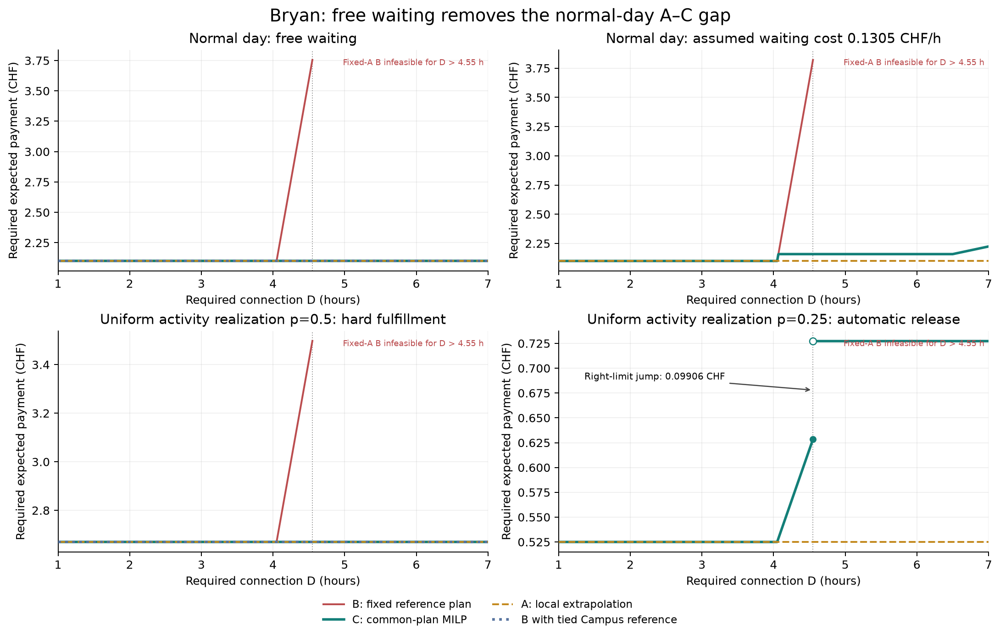
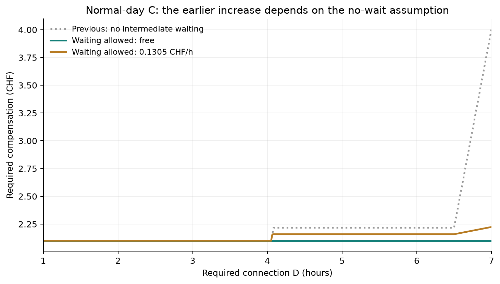
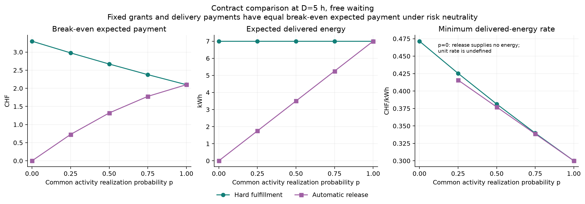
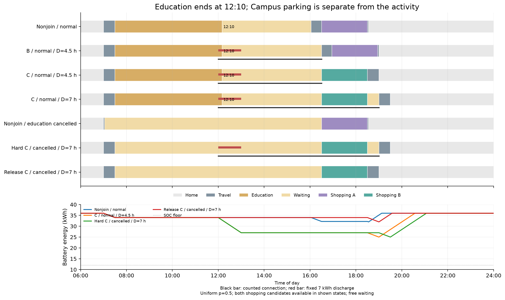

# Bryan再計算：途中待機・一律発生確率p・契約形態

無料の途中待機を許すと、通常日のCはD=1〜7時間の全域で2.10 CHFとなり、前回のA–C差は消えた。教育は全ての実現状態で07:30〜12:10の4時間40分に収まり、長い教育滞在は解消した。一方、一律pの不確実性と教育取消時の自動解除を組み合わせると、前日の買物場所固定に由来するA–C差と、条件によっては補償額の跳びが残った。

この結果は掲載人物Bryanの入力を用いる仮定付き診断例であり、Swiss MTMCの実測スケジュールの再現や実際の受諾額の推定ではない。原稿の本文・数式・科学的主張は変更していない。

## 設定と原稿への対応

[実行前設定](../../experiments/bryan_waiting/settings_contract.md)と[出典監査](../../experiments/minimal_contract/source_provenance.md)を参照。原稿のBernoulli定義とdecision-002に合わせ、主実験は教育・Shopping A・Shopping Bが**それぞれ独立に共通の発生確率p**で実現する。p∈{0,.25,.5,.75,1}で8状態を列挙し、自宅は確実、確率0の状態は制約から除く。pは取消確率ではない。

前日に加入・契約・予定買物場所を決め、06:00に全実現状態が判明する。最初の出発07:00、残存活動の所要時間、相対順序、予定場所は維持する。非実現の買物を他の場所へ振り替えない。途中待機をCampusとDowntownに追加し、教育終了と物理的なCampus出発を別変数にした。Campus買物後の待機も許す。教育時間は生存状態間で共有し、元の延長不効用を残した。

教育が消えた状態でも共通出発を維持するため、直接Shopping Aへ行く場合は07:03到着から16:30まで、Campusへ行く場合は07:30到着から待機する。この長い取消時待機は、元の共通出発制約を保った結果である。自宅へ一度戻る行程、未知の新規活動、自由な場所再選択は導入していない。全活動が消えサービスもない状態は自宅に留まる。

初期・終端エネルギー36 kWh、下限12 kWh、容量60 kWh、効率1、帰宅後7 kW充電、電力費0.30 CHF/kWh、金銭係数0.3効用/CHFを共通とした。Home–Shopping Aの逆方向0.05 h・1 kmは追加の対称OD仮定である。

## 1. 待機を許したA・B・C

AはD=4時間の固定整数LP双対による外挿、Bはその参照点の全整数選択を固定したLP再最適化、Cは全シナリオに共通の予定場所を含むMILP最適化である。Aは別の活動スケジュールを生成しない。数表の補償額は無報酬加入と最適非加入の**期待効用差**をCHFへ換算した値で、図の個別状態の負担とは区別する。

以下は無料待機、金額はCHF。

| 一律発生p | 契約 | 必要接続D | A | B | C | 期待放電量 |
|---:|---|---:|---:|---:|---:|---:|
| 1 | 確実履行 | 4.5 h | 2.10000 | 3.58950 | 2.10000 | 7 kWh |
| 1 | 確実履行 | 7 h | 2.10000 | 実行不能 | 2.10000 | 7 kWh |
| 0.5 | 確実履行 | 4.5 h | 2.67000 | 3.41475 | 2.67000 | 7 kWh |
| 0.5 | 教育取消で自動解除 | 4.5 h | 1.05000 | 1.42237 | 1.32000 | 3.5 kWh |
| 0.5 | 教育取消で自動解除 | 5 h | 1.05000 | 実行不能 | 1.32000 | 3.5 kWh |
| 0.25 | 教育取消で自動解除 | 4.55 h | 0.52500 | 0.62844 | 0.62844 | 1.75 kWh |
| 0.25 | 教育取消で自動解除 | 5 h | 0.52500 | 実行不能 | 0.72750 | 1.75 kWh |

確実履行・無料待機の参照点では、Shopping AとBの計画は同額になる。上表のBは明示した規則でAを選んだ参照であり、同額のBを参照にすると、その固定計画の補償曲線はCと一致する。したがって、この条件のB–C差を個人に固有で一意な負担として主張できない。確実履行のA=Cという帰無結果も保存した。

通常日D=4.5時間のCは前回2.21745 CHFから今回2.10 CHFへ、D=7時間では4.00295 CHFから2.10 CHFへ変わった。前回の教育延長で生じた上乗せを、そのまま論文の主結果に使う根拠はなくなった。

## 2. 契約の履行条件と支払基準

| 履行条件 | 指令電力量 | 接続条件 | 固定額支払 | 実績支払 |
|---|---|---|---|---|
| 確実履行 | 全状態12:00〜13:00に7 kWh | 12:00〜19:00にD時間以上 | 加入固定額F | 実放電量×単価r |
| 教育取消時に自動解除 | 教育実現なら7 kWh、非実現なら0 | 非実現時は接続義務も0 | 解除時もFを保持、返金・解除料0 | 解除時支払0 |
| イベントのみ（対照） | 全状態12:00〜13:00に7 kWh | 当該1時間のみ | 加入固定額F | 実放電量×単価r |

自動解除は外生的な指令停止であり、解除するかどうかを選ぶモデルではない。解除状態でCampusへ買物に行っても、任意の追加放電や実績支払は認めない。

p=.5、D=4.5時間、無料待機での全再最適化Cは次のとおり。

| 条件 | 必要固定額＝必要期待支払 | 期待放電量 | 7 kWhイベントの供給確率 | 最低実績単価 |
|---|---:|---:|---:|---:|
| 確実履行 | 2.67000 CHF | 7 kWh | 1 | 0.381429 CHF/kWh |
| 自動解除 | 1.32000 CHF | 3.5 kWh | .5 | 0.377143 CHF/kWh |
| イベントのみ | 2.67000 CHF | 7 kWh | 1 | 0.381429 CHF/kWh |

このリスク中立・外生指令の例では、同じ履行条件の下で固定額と実績支払の必要**期待支払**は等しい。実績単価は期待負担÷期待放電量で厳密に求まる。活動選択で指令電力量を変えられる場合や選択的解除には、この比をそのまま使えない。期待放電量0・負担0では単価は無意味であり、期待放電量0・正の負担なら有限実績単価で補償できない。保存値のrate_statusで区別した。

自動解除の支払減は供給量減を伴う。確実履行と同じ供給商品で安価になるとは解釈しない。また、一続きのCampus訪問しかないため、固定接続区間[12:00,12:00+D]と今回の累積D時間は、活動と供給の実行可能性へ射影すれば同じ条件になる。この二つを異なる契約効果の証拠には使わない。

## 3. 不確実性で残った差と手計算

無料待機では、非加入の予定A計画の期待走行電力は4p+0.4p(1-p) kWhである。確実履行は全状態で走行4 kWhと放電7 kWhを回復するので、

`C_hard = 0.30 × [11 − 4p − 0.4p(1−p)] = 3.30 − 1.32p + 0.12p² CHF`。

p=.5では2.67 CHFとなる。通常日2.10との差0.57 CHFは、教育取消の効用を二重に損失計上したものではなく、非加入なら省ける走行の電力費である。正の待機費用がなければ、契約の長さによるCの増加は消える。

自動解除では、前日の予定場所を共通にするため、二つの計画の期待負担は

`K_A = 2.10p + 3.31p² max(0,D−4.05)`、

`K_B = 2.10p + 1.08p(1−p)`。

p>0でAが実行可能なのはD≤4.55時間。Cは実行可能な二計画の下側を選ぶ。p=.5では参照A=1.05 CHFからC=1.32 CHFへ上がり、D=4.5でAの局所外挿との差0.27 CHFが残る。この場合の参照Aは厳密に有利で、確実履行の同額参照問題とは異なる。

p=.25ではD=4.55時間のC=0.6284375 CHFから、その直後の右極限0.7275 CHFへ**0.0990625 CHFの跳び**が現れた。境界の直前・厳密値・1分後を解き、独立式の右極限と照合した。図の白丸は解析的右極限であり、境界で実際に得られる数値解と区別した。これは教育滞在の延長による跳びではなく、場所を前日に固定し、実現後に代替できないことと硬い買物時間窓による。

全ての離散選択で跳びが生じるわけではない。p=.5の自動解除は約D=4.376284時間で連続に場所を切り替え、無料待機の確実履行は一貫して一定であった。

## 4. 待機費用の感度

無料待機に加えてgamma=.03915効用/時＝0.1305 CHF/時を仮定した。これは推定値ではなく、教育延長の係数.0783効用/時より小さい診断用感度である。教育を延ばして待機に置き換える方が安くなる設定を避け、元の延長係数も保持した。

以下は全てC、金額はCHF。

| 発生p | 契約 | D | 無料待機のC | 仮定した待機費用ありのC |
|---:|---|---:|---:|---:|
| 1 | 確実履行 | 4.5 h | 2.100000 | 2.158725 |
| 1 | 確実履行 | 7 h | 2.100000 | 2.223975 |
| 0.5 | 確実履行 | 4.5 h | 2.670000 | 3.105000 |
| 0.5 | 自動解除 | 4.5 h | 1.320000 | 1.461375 |

正の待機費用を置くとA–C差は再び現れる。ただし数値の大きさは仮定した待機費用と07:00共通出発に条件付けられる。実際の待機評価や、取消後に自宅出発を遅らせる自由を推定・検証した結果ではない。

## 5. 活動スケジュールとSOC

図はp=.5の共通計画から、Shopping A/Bが両方実現した状態の教育あり・なしを抜き出した例である。曲線の期待値を一つの実現スケジュールとして描いていない。教育は12:10に終わり、その後の時間は待機として区別される。必要接続7時間でも、Campus買物16:30〜18:30の後に19:00まで待つことができる。自動解除の教育なし状態では放電は0だが、予定Bが実現すればCampusでの買物と往復は残る。

日初・日末のエネルギーを一致させ、走行・放電・帰宅後回復を全状態で再積分した。SOCは今回の切替の原因ではなく、物理的整合性の検査である。

## 検証・再現性・証拠の範囲

- 全比較8,160行、うち主uniform 2,550行。全Cで求解成功。
- 8,192組のMILP/固定LP/独立パターンLPを照合。MILP対列挙最大差7.11e-15効用、最大報告MIP gap 4.71e-16。
- 独立手計算の有効値30,966個の最大差3.55e-14 CHF、実行可能性32,640件も一致。
- 参照双対と±1分差分の最大差6.33e-14効用/時。双対は固定整数LPに限る。
- 全61,026本の状態・パターンスケジュールでSOC、充電終了、移動、接続条件を確認。最大主制約残差2.93e-13。
- 完全列挙した有限状態の期待値なのでMonte Carlo誤差・乱数seed・統計的信頼区間は適用しない。pは設計要因であり、人口の発生率ではない。

| 主張 | 証拠ゲート | 状態 | 根拠と解釈の範囲 |
|---|---|---|---|
| 待機による通常日のA–C差消失 | G0入力/G1実装/G2公平/G3数量/G4機構/G5境界/G7条件付き解釈 | PASS | 前回保存値、共通条件、実MILP・LP・独立解析、参照B感度、教育終了時刻 |
| 自動解除・共通場所で差や跳びが残る | G0〜G5/G7 | PASS | uniform8状態、p別境界、硬い買物窓、共通予定場所、解析式と解の一致 |
| 待機費用感度 | G0〜G5/G7 | PASS | 0と明示した正の仮定、全非自宅待機、共通出発を保持した比較 |
| Swiss居住者全体の受諾額・現実的負担・他の不確実性への転用 | G6外的妥当性 | UNOBSERVED | 行動推定・母集団・未知活動・緊急離脱を検証していない。一般化しない |

研究上の判断は「前回の増加を維持する」ではなく、無料待機で消える差を撤回し、残る差を共通の事前計画・契約履行・待機費用の条件に分けることである。契約形式を変えたという名称だけでは差は生じず、支払期待値が同じになる対照も保持した。原稿への科学的主張の適用は行っていない。

## ファイル

- [設定](waiting_contracts_01/config.json)、[環境](waiting_contracts_01/environment.json)、[全体検算](waiting_contracts_01/verification.json)
- [独立数理監査](waiting_contracts_01/independent_math_audit.json)、[出典・比較公平性監査](waiting_contracts_01/source_fairness_audit.json)
- [補償額・供給CSV](waiting_contracts_01/compensation.csv)、[手計算照合CSV](waiting_contracts_01/handcheck.csv)、[参照双対CSV](waiting_contracts_01/references.csv)
- [求解状態CSV](waiting_contracts_01/solver_status.csv)、[全求解記録gzip](waiting_contracts_01/solver_records.jsonl.gz)、[SOC監査CSV](waiting_contracts_01/soc_audit.csv)、[代表状態スケジュールJSON](waiting_contracts_01/schedules.json)
- [A/B/C PDF](waiting_contracts_01/figures/compensation_ABC.pdf)、[活動・SOC PDF](waiting_contracts_01/figures/activity_schedules_soc.pdf)、[契約比較PDF](waiting_contracts_01/figures/contracts_uncertainty.pdf)
- [独立解析の導出](../../experiments/bryan_waiting/analytic_notes.md)、[再実行手順](../../experiments/bryan_waiting/README.md)

各runには設定・結果・overview・discussion・ソーススナップショットを保存した。教育単独取消・買物単独取消はflexible departureによる補助実験で、主uniformの固定07:00出発とは混ぜていない。前回の `outputs/20261016_minimal_contract/` は上書きしていない。
