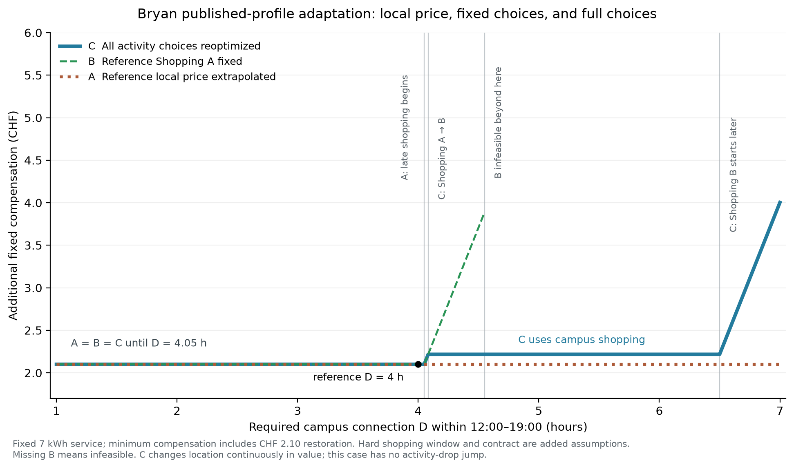
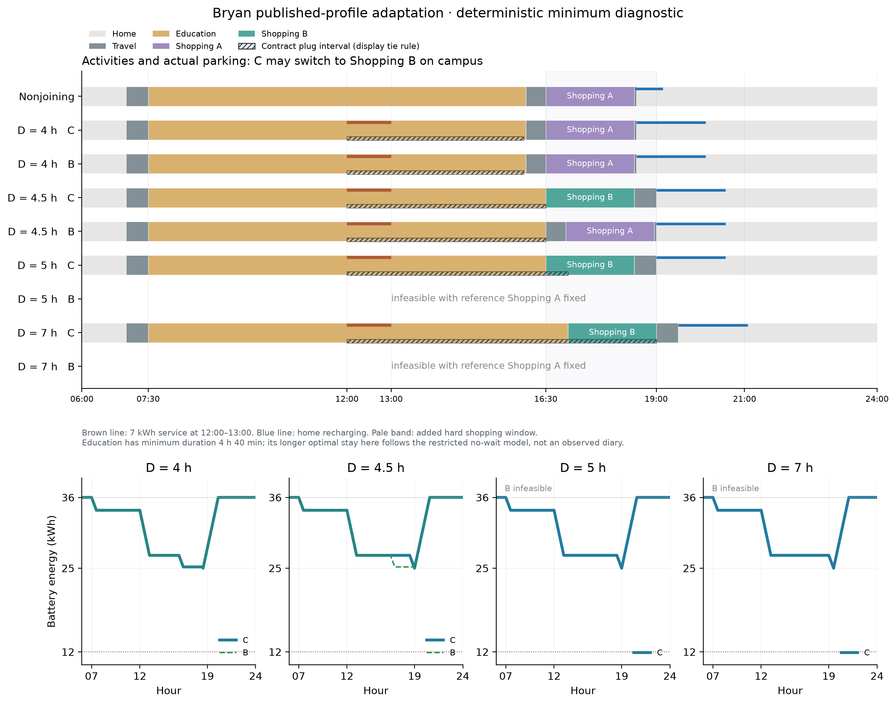
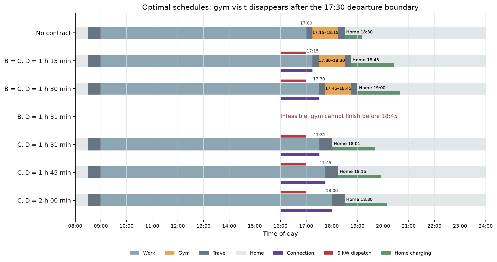

# 最小数値実験の実行結果（2026-10-16）

最初の掲載人物例には、Wang, Pougala and Hillel (2025), [Joint modelling of electric vehicle charging and daily activity scheduling](https://doi.org/10.1016/j.trd.2025.104911) のBryanを使用した。Tables 3–4の活動候補・希望時刻・希望所要時間とAppendix Aの係数を採用し、V2G・時間窓・距離・SOC境界等を明示して追加した**診断用の縮約例**である。掲載入力はSwiss MTMCに基づくが、この実験は実測日誌や原論文全体の数値再現ではない。出典と追加仮定の一覧は[出典監査](../../experiments/minimal_contract/source_provenance.md)を参照。

## 比較の定義

Aは参照点の固定整数LPの双対値を使う線形外挿、Bは参照点の全整数選択を固定したLP再最適化、Cは許した活動参加・場所選択を含むMILP再最適化である。Aは活動スケジュールを生成しない。両例とも時刻は連続で、同じ例のA/B/Cでは初期・終端SOC、放電量、効用と料金を揃えた。実行不能のBは欠損として残した。

## 1. Bryan：場所変更による適応

教育は希望07:30開始・4時間40分、買物は希望16:30開始・2時間とし、DowntownのShopping AとCampusのShopping Bを択一とした。今回は教育開始を固定、教育時間を希望以上で調整可、買物時間を2時間に固定した。買物の硬い窓16:30–19:00、OD、V2G設備、契約は追加仮定である。

Campusで12:00–13:00に7 kWhを放電し、12:00–19:00の中で必要接続時間Dを1～7時間へ変更した。参照点はD=4時間。0.3効用/CHFを共通金銭係数とする追加仮定の下で、補償額をCHFへ換算した。追加充電費2.10 CHFは全条件で同じである。

| 必要接続D | A：局所外挿 | B：Shopping A固定 | C：全再最適化 | Cの買物場所 |
|---:|---:|---:|---:|---|
| 4時間 | 2.10000 CHF | 2.10000 CHF | 2.10000 CHF | Downtown |
| 4時間30分 | 2.10000 CHF | 3.70695 CHF | 2.21745 CHF | Campus |
| 5時間 | 2.10000 CHF | 実行不能 | 2.21745 CHF | Campus |
| 7時間 | 2.10000 CHF | 実行不能 | 4.00295 CHF | Campus |

参照点には3分の余裕があり、Aの影価格は0となった。D=4.05時間で固定場所のスケジュールに遅れが生じ、CはD=4.082889947時間（約4時間4分58秒）でCampusの買物へ切り替えた。場所選択は離散的に変わるが、この場合の補償額は連続である。BはD=4.55時間（4時間33分）を超えると実行不能になり、CはCampusで買物を続けることで履行できた。

図の長い教育滞在は、途中待機と追加活動を許さない縮約設定の結果であり、実際の学生の一日として解釈しない。全加入ケースの走行消費4 kWhと放電7 kWhは共通で、帰宅時25 kWhから11 kWhを充電して日末36 kWhへ戻る。SOCはこの場所切替の原因ではない。

86条件すべてでCの最適性が確認され、報告MIPギャップは0だった。独立した3パターンのLP列挙との目的値差は最大1.78e-15効用、手計算との補償額差は最大6.22e-15 CHFだった。主制約残差は最大3.55e-15。参照双対0は左右1分の有限差分でも確認した。

- [設定](bryan_01/config.json) / [補償額CSV](bryan_01/compensation.csv) / [手計算照合CSV](bryan_01/handcheck.csv)
- [検証記録](bryan_01/verification.json) / [全求解・SOC記録](bryan_01/solver_records.json)
- [補償額PDF](bryan_01/compensation.pdf) / [活動・SOC PDF](bryan_01/schedules_soc.pdf)
- [実験概要](bryan_01/overview.md) / [考察](bryan_01/discussion.md)

## 2. 事前に設定した合成例：活動断念と手計算の照合

勤務・任意運動の設定を変えず、参照D=1.25時間で実行した。こちらは円相当の合成尺度であり、BryanのCHFとは比較しない。

| 必要接続D | A | B | C | 事前の手計算C |
|---:|---:|---:|---:|---:|
| 1時間 | 180 | 180 | 180 | 180 |
| 1時間15分 | 630 | 630 | 630 | 630 |
| 1時間30分 | 1,080 | 1,080 | 1,080 | 1,080 |
| 1時間45分 | 1,530 | 実行不能 | 4,080 | 4,080 |
| 2時間 | 1,980 | 実行不能 | 4,380 | 4,380 |

D=1.5時間までは運動が実行可能で、A=B=Cとなった。それを超えるとBは実行不能となり、Cは運動を断念した。境界直後の補償増加は2,700円相当で、単純な参加便益3,000円ではない。境界時点で既に300円相当の遅れ負担を受けていたためである。図の右極限は解析値として明記し、数値サンプル点と区別した。

29条件すべてでCの最適性と報告ギャップ0を確認した。全条件の手計算との差は最大1.14e-13円相当、独立した活動列LP列挙との差は0だった。参照双対1,800/時は左右1分の有限差分に一致した。44本の解スケジュールでSOC・充電終了時刻を計算して検証し、最大エネルギー収支残差、SOC境界違反、時間制約違反はすべて0だった。

- [補償額CSV](synthetic_02/compensation_sweep.csv) / [事前5点の手計算照合CSV](synthetic_02/hand_comparison.csv)
- [活動時刻CSV](synthetic_02/activity_schedules.csv) / [検証記録](synthetic_02/independent_checks.json) / [SOC記録](synthetic_02/soc_checks.json)
- [補償額PDF](synthetic_02/compensation_ABC.pdf) / [活動PDF](synthetic_02/activity_schedules.pdf)

## 解釈と残る範囲

この比較は、連続部分の制約切替と離散的な活動選択変更を分けて評価する必要を示す。Bryanでは場所変更が負担を抑え、合成例では場所の代替がないため活動断念となった。離散選択があるだけで価値が必ずジャンプする、あるいは不確実性が必ず補償を増やす、という結果ではない。

本実験は決定論的で、SOC下限を非拘束にした機構・実装検証である。実際の受諾額、母集団での発生頻度、活動取消や緊急時の解除権、電池劣化、全原稿モデルの性能は検証していない。既存原稿の科学的主張や数式は変更していない。

## 保存と再現性

各runに設定・結果・overview・discussion・環境・実行ソースの完全スナップショットを保存した。`synthetic_01`は最初の記録として保持し、計算によるSOC検証を追加した`synthetic_02`を最終参照とする。初回の補償額・図・設定を上書きしていない。[全体照合](bundle_verification.json)で3スナップショットのハッシュと保存値を確認した。コードと再実行手順は[実験フォルダ](../../experiments/minimal_contract/README.md)にある。
