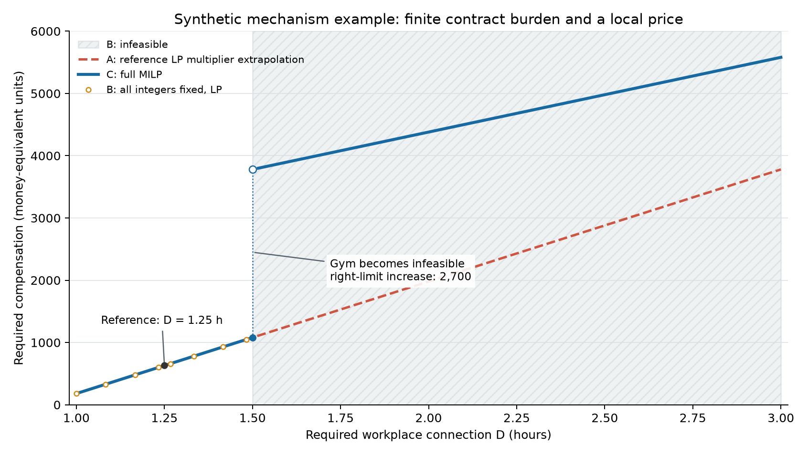
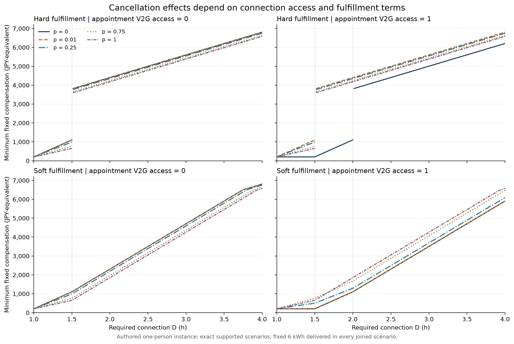
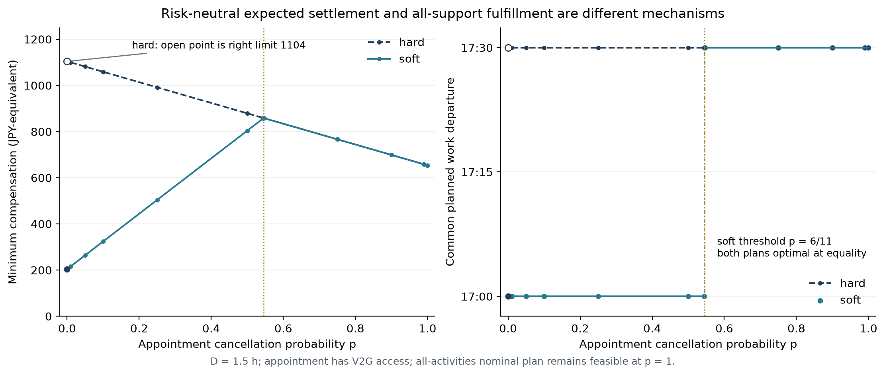
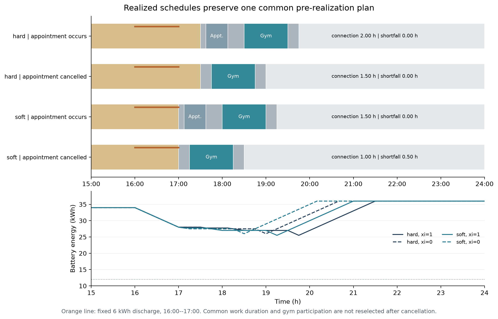
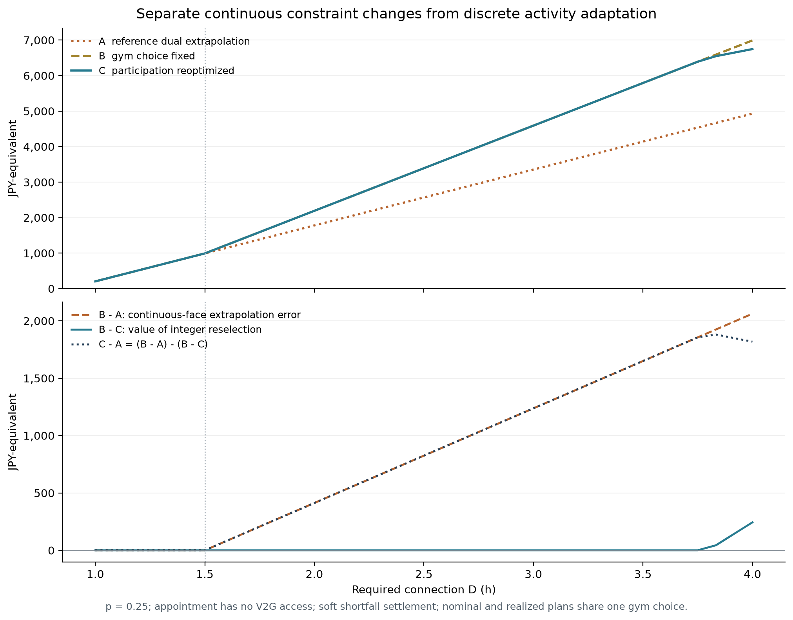
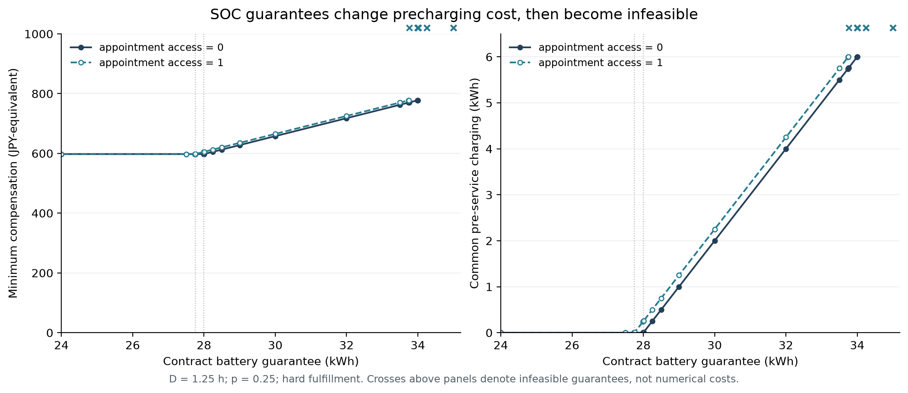

# 理論的基礎づけに基づく契約数値実験（2026-10-16）

**新しい取消・SOCの4,996条件を実行し、全条件を別定式化LPと解析計算で照合した。** 判定はモデル内の機会費用・受諾条件であり、実際の日本の契約受諾を推定した結果ではない。既存の掲載人物・合成例の再実行を含む4実験を保存した。

## 比較する量

加入と非加入をそれぞれ最適化し、追加報酬を除く期待費用差を符号付き機会費用、その正の部分を必要固定補償とした。新モデルの金銭限界効用は1、単位は設計した円相当。BryanのCHFとは集計しない。

Aは参照D=1.25hの固定整数LPの双対を外挿する。Bはその運動参加を固定して連続変数だけを再最適化。Cは運動参加も含むMILPを解く。Bが有限の条件では、`C-A=(B-A)-(B-C)`を検算した。最大恒等式残差は0。Aは活動計画ではなく価格予測である。

## 1. 既存例の再現：連続的な場所変更と不連続な活動断念

最新の既定ブランチに保存されていたBryanと合成例を、新しい出力先で再実行した。BryanはWang et al. (2025)の公開入力にV2G・硬い窓等を加えた縮約例で、原論文全体や実測日誌の再現ではない。[出典・追加仮定](../../../experiments/minimal_contract/source_provenance.md)を参照。

- Bryan：参照D=4hの影価格は0。D=4.05hから固定場所の遅れが生じ、約4.08289hで買物場所を変更。補償額は連続。D=4.5hでA=2.10、B=3.70695、C=2.21745 CHF。固定場所Bは4.55hを超えると実行不能。
- 合成例：D=1.5hを超えると任意運動を断念。境界の補償増加は2700円相当。D=1.75hではA=1530、C=4080で、Bは実行不能。

同じ「離散選択あり」でも、連続な切替と不連続な断念の双方を保持した。両例の完全な設定、求解状態、独立照合、SOCは各サブフォルダに保存している。

## 2. 取消と契約履行：同じ活動・同じ6kWhでも必要補償が変わる

新モデルは勤務→予定1件→任意運動→自宅の共通計画を作る。予定が取消された場合はその活動を削除し、残存所要時間・順序・勤務終了・接続計画を維持する。同じ活動場所でV2G設備アクセスだけを変えた。勤務終了後の予定の取消は移動と滞在を短縮するが、設備がある場合は接続0.5時間も失わせる。

全加入状態で16–17時に6kWhを実際に放電する。累積接続義務は別にD時間で、hardは全支持状態で不足禁止、softは不足1時間あたり2400の有限精算である。期待供給量と物理的SOC条件を揃え、契約の可用性義務と実際の供給を混同していない。

D=1.5hの測定値は以下。履行確率は接続D時間の達成確率で、6kWhの供給確率とは異なる。

| 取消確率p | 予定場所の設備 | 仕様 | 必要補償（円相当） | 共通勤務終了（時） | 期待不足（h） | 履行確率 |
|---:|---:|---|---:|---:|---:|---:|
| 0 | 0 | hard | 1,104.00 | 17.50 | 0.0000 | 1.00 |
| 0 | 0 | soft | 1,104.00 | 17.50 | 0.0000 | 1.00 |
| 0 | 1 | hard | 204.00 | 17.00 | 0.0000 | 1.00 |
| 0 | 1 | soft | 204.00 | 17.00 | 0.0000 | 1.00 |
| 0.01 | 0 | hard | 1,099.50 | 17.50 | 0.0000 | 1.00 |
| 0.01 | 0 | soft | 1,099.50 | 17.50 | 0.0000 | 1.00 |
| 0.01 | 1 | hard | 1,099.50 | 17.50 | 0.0000 | 1.00 |
| 0.01 | 1 | soft | 216.00 | 17.00 | 0.0050 | 0.99 |
| 0.25 | 0 | hard | 991.50 | 17.50 | 0.0000 | 1.00 |
| 0.25 | 0 | soft | 991.50 | 17.50 | 0.0000 | 1.00 |
| 0.25 | 1 | hard | 991.50 | 17.50 | 0.0000 | 1.00 |
| 0.25 | 1 | soft | 504.00 | 17.00 | 0.1250 | 0.75 |
| 0.75 | 0 | hard | 766.50 | 17.50 | 0.0000 | 1.00 |
| 0.75 | 0 | soft | 766.50 | 17.50 | 0.0000 | 1.00 |
| 0.75 | 1 | hard | 766.50 | 17.50 | 0.0000 | 1.00 |
| 0.75 | 1 | soft | 766.50 | 17.50 | 0.0000 | 1.00 |
| 1 | 0 | hard | 654.00 | 17.50 | 0.0000 | 1.00 |
| 1 | 0 | soft | 654.00 | 17.50 | 0.0000 | 1.00 |
| 1 | 1 | hard | 654.00 | 17.50 | 0.0000 | 1.00 |
| 1 | 1 | soft | 654.00 | 17.50 | 0.0000 | 1.00 |

アクセスあり・hardでは、p=0の必要補償204.00に対し、p=0.01では1099.50になった。取消状態を完全履行の支持集合に含めると、共通勤務を17:30まで延ばす必要がある。これは小さな確率に対するリスク回避の推定ではなく、全支持履行制約による境界である。

アクセスあり・soft・D=1.5hでは、勤務延長の限界費用`1800-900p`と不足精算の期待限界額`2400p`がp=6/11=0.545455で一致する。直前p=0.544455の勤務終了は17.00時、直後p=0.546455では17.50時だった。等号では複数の最適な勤務終了があり、一つのソルバー選択を一意な予測としない。境界の必要補償は858.55。この例の補償額は取消確率に単調増加しない。

## 3. 局所近似の誤差と活動再選択を分ける

同じ活動を維持しても、接続不足の精算や時刻の制約面が変わればBとAは乖離する。Cは活動を断念・維持する選択も比較するためB以下の期待費用になる。Bが実行不能な条件で、この二つの有限値の差を作っていない。有限Bの条件で観測された最大の連続外挿誤差B-Aは5700.00、最大の整数再選択価値B-Cは300.00だった。

所与の固定報酬での受諾は、同じCの必要補償から判定できる。例えば報酬1000では、Aの比較が可能な2236条件中、216条件でAとCの判定が異なった。これは事前に指定した条件格子上の件数であり、母集団の誤判定率ではない。全報酬水準と条件別の判定はCSVと`summary.json`に残した。

## 4. SOC保証：限界費用の発生と物理的な実行不能

勤務到着時SOCは34kWh、6kWh放電後は事前充電なしで28kWhとなる。予定場所にも保証が適用される場合は、移動消費0.25kWhによって27.75kWhから事前充電が必要になる。事前の勤務内充電は家庭より30円相当/kWh高いため、実行可能域で保証1kWhの増加につき必要補償が30円相当増える。

予定場所にも設備がある場合、保証33.75kWh超は事前充電6kWh上限で実行不能。設備なしの場合、34kWhまでは実行可能で、それを超えると到着時保証にも違反する。SOC実験の540条件の実行不能を保持した。これは高い有限補償では解消できない。

この設計では、実行可能域のSOC保証の費用は時間条件に加算される形であり、活動取消との非加法的効果を常に生むわけではなかった。この帰無的な範囲も保持する。SOCを後から描いただけでなく、事前充電と実行可能性を決める制約として求解し、全イベント残量を独立に再計算した。

## 検証と主張の範囲

各実験の`verification.json`はPASS。新モデルの全条件を、二つの独立な経路LPと、費用の折れ点を列挙する解析計算で確認した。参照LPの双対は左右0.0001時間の差分に照合した。全シナリオの活動時刻・固定計画・SOC・日末残量・供給・精算・目的値を再計算した。MIPは相対ギャップ0、1スレッド、1求解10秒上限で実行した。タイムアウトを最適値と扱わない。

この結果が支持するのは、指定したモデルでの、局所価格の成立域、活動変更・取消・SOC保証による境界と受諾判定の差である。全原稿モデル、未知の緊急活動や事後解除権のオプション価値、実際の補償額、福島の母集団への外的妥当性はUNOBSERVED。原稿本文・科学的主張台帳は変更していない。共有知識IDの適用はない。

- [全体設定](settings.json) / [環境・版・ソースハッシュ](environment.json) / [集計](summary.json)
- [取消の全条件CSV](cancellation_01/results.csv) / [検証](cancellation_01/verification.json) / [原始記録](cancellation_01/solver_records.jsonl.gz)
- [SOCの全条件CSV](soc_01/results.csv) / [検証](soc_01/verification.json) / [原始記録](soc_01/solver_records.jsonl.gz)
- [主張と検証条件の監査](claim_gate_audit.json)

各サブ実験に設定・原始結果・ソース・overview・discussionを保存した。図はPNGとPDFの両方を`figures/`に保存している。
